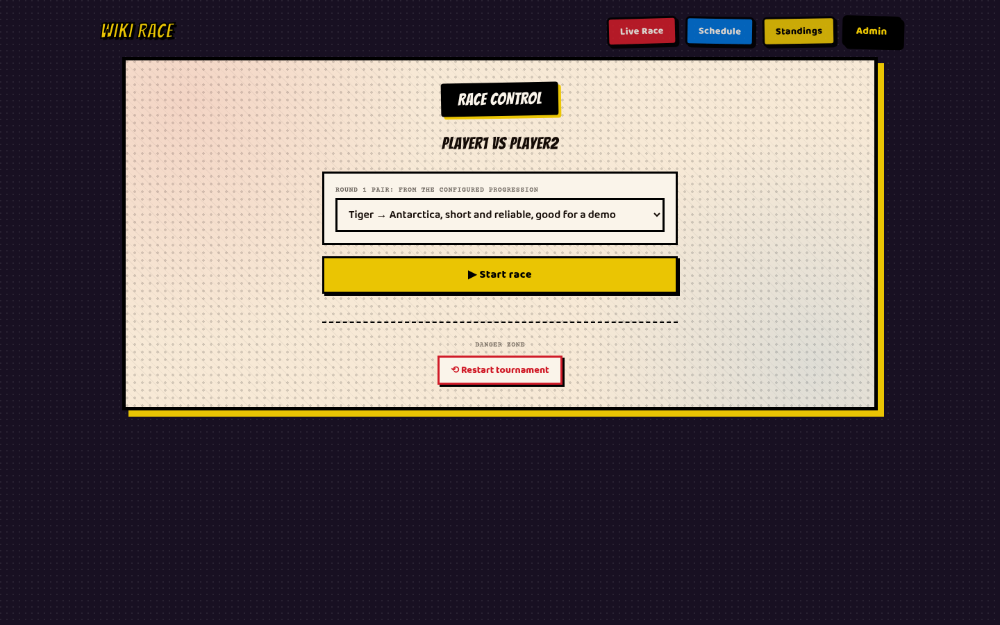
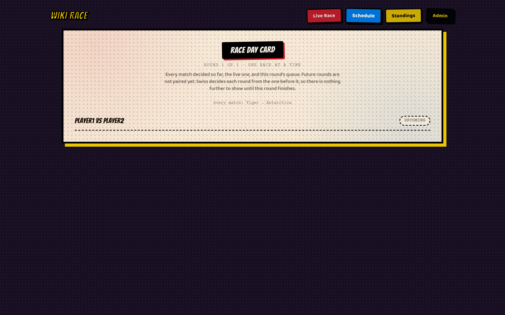
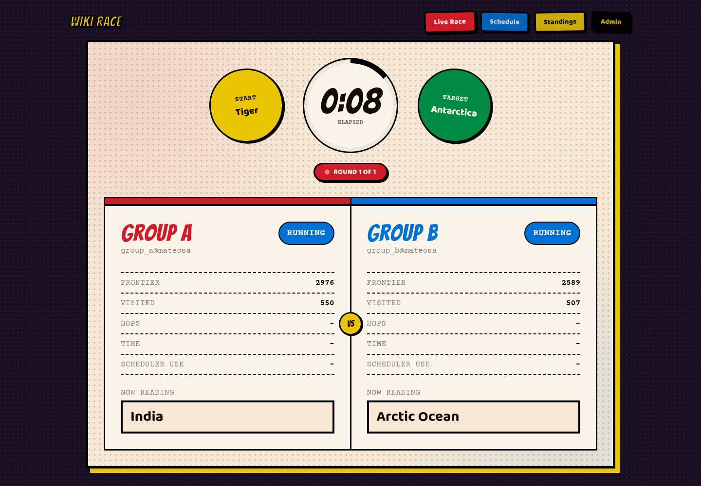
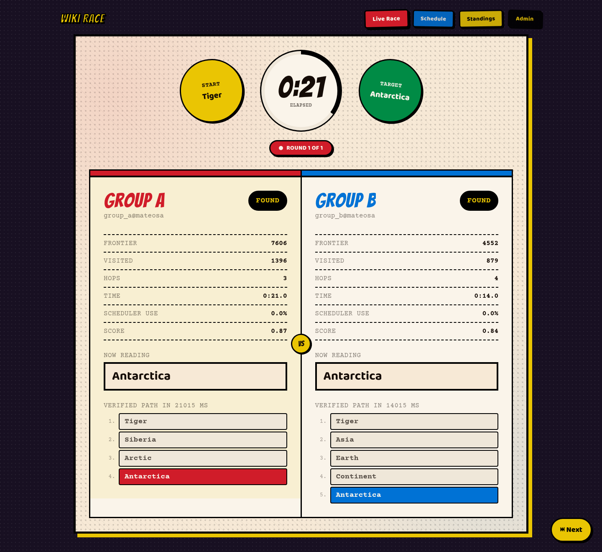
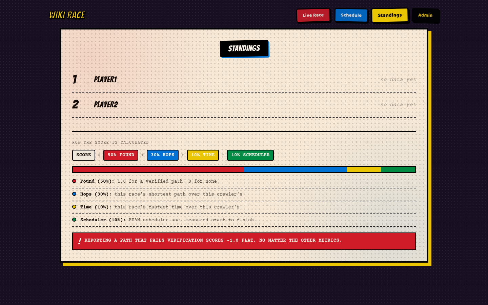

# WikiRace Competition Platform

## Overview

WikiRace is a project for a university course on concurrency, distribution, and
parallelism. Each group writes a web crawler in Elixir that races another group's
crawler to find the shortest link path between two Wikipedia articles, by actually
following links, not by calling a search API.

The point of the assignment is the crawler, not the platform around it. This repo is
that whole system: it deploys both crawlers, starts the race at the same instant for both
sides, watches their progress, checks that any path they claim to have found is real,
and scores the result. You never touch any of that. You only write the code that
decides which link to follow next and how to spread that work across processes and,
if you want the top score, across your own cluster of nodes.

Because the course is about concurrency and distribution, the rules are strict on
purpose:

- Your crawler is a plain OTP application. The only things you may add are Req (to
  fetch pages) and Floki (to parse HTML). No crawler libraries, no job-queue
  libraries, no shortcuts that would do the concurrency for you.
- All the concurrency, coordination, and distribution has to be things this course
  actually teaches.
- Every group races the same Wikipedia snapshot, offline, so nobody gets
  rate-limited or blocked, and everybody sees the same content.

## Architecture

Four machines, on a private network, each with one job:

- Wikipedia VM: runs Kiwix, serving a full offline snapshot of English Wikipedia.
  Crawlers fetch pages from here, never from the real wikipedia.org.
- Platform VM: runs this Phoenix app. It is the referee (the "harness"), the live
  dashboard, and the thing that deploys releases to the two Player VMs.
- Two Player VMs: one per competing group, each running that group's crawler as a
  deployed OTP release.

Player VMs connect to the platform over Erlang distribution, the same way any two
BEAM nodes talk to each other. The platform VM connects to each player VM over SSH
only to deploy and start the release. Once the release is running, all further
communication is the Erlang connection.

## Student deliverable

Each group ships their crawler as an Elixir OTP application on GitHub. It must
implement a behaviour with two functions: `start(start_url, target_url)`, which
returns `{:ok, pid}`, and `status(pid)`, which returns the crawler's current state.
Students may use Req for HTTP and Floki for HTML parsing. All concurrency,
distribution, and coordination must be built with standard OTP: GenServers, dynamic
supervisors, ETS, and Erlang distribution. No other libraries for that part.
The platform builds the deliverable with `MIX_ENV=prod mix release`, so that command
must succeed on a fresh clone of the group's tag. `player/README.md` is the starting
point and lists what to implement.

## Competition flow

Deployment happens once per group, before the tournament starts, not once per match.
For every group, the professor clones their tagged release, adds an entry to the
deploy manifest, and deploys and starts that group's release from the terminal
(`mix wiki_race.deploy` / `mix wiki_race.start`, no web UI for this step). Each
release keeps running for the rest of the tournament, connected to the harness the
whole time.

Once every group's node is connected, the professor runs the whole tournament from
`/admin`, one click per match: it resolves that match's two groups to their
already-connected nodes, reveals that round's start and target article pair to both
crawlers at the same time, and starts the race. Every match in a round uses the same
pair, so wait times stay predictable. Both crawlers then race against the local
Wikipedia VM while the dashboard shows each one's current node, frontier size, path
found so far, and elapsed time. The race ends when both crawlers find a path or the
time limit runs out, and the next click advances to the next match. Nothing gets
redeployed in between.

## The platform

These screenshots come from a demo race on the local setup, with two scripted crawlers
standing in for real groups.

`/admin` is where the professor picks the article pair for the round and starts each
match.

`/schedule` shows the matches of the current round and which one is next.

During a race, the dashboard at `/` shows both crawlers side by side: frontier size,
pages visited, and the article each one is reading right now.

When a crawler reports a path, the harness verifies it link by link before it counts.
Once the race ends, each side shows its hops, its time, its scheduler use, its score,
and the verified path. Here Group B was faster, but Group A found the shorter path and
wins on score.

`/standings` ranks the groups across the tournament and shows how the score is built.

## Grading

Matches are 1v1. Each crawler gets a single score built from four parts: whether it
found a valid path, how its path length compares to the other crawler's, how its
time compares, and how well it used its schedulers. Highest score wins. Reporting a
path that turns out to be wrong scores a flat -1.0, no matter the rest. See
`SCORING.md` for the exact formula.

The tournament has four Swiss rounds. Each round pairs groups that are close in the
standings, ranked by wins and then by total score, and never repeats a pairing that
has already been played. When the number of groups is odd, one group gets a bye in
each round. A bye is a scored solo time trial, not a free win. The pairing generator
and the number of rounds are set in `platform/config/config.exs`.

## Running it locally

You get this whole repo before competition day, and `docker compose up` gives you
all four machines above as four containers on your own laptop:

| Container             | Stands in for       |
| ---------------------- | -------------------- |
| `kiwix1`               | the Wikipedia VM     |
| `platform`             | the Platform VM      |
| `player1`, `player2`   | the two Player VMs   |

This is not a simplified copy. `platform` runs the exact same Phoenix app, against
the exact same Wikipedia snapshot, that runs on competition day. The default local
loop skips the SSH deploy step. Instead, `player1` and `player2` just build and run
your `player/` checkout directly. So if your crawler works here, it works on
competition day, full stop. Full setup and troubleshooting is in `RUNNING.md`. The
short version:

1. `make up` starts all four containers, downloading the Wikipedia snapshot first
   if you don't already have it (it's large, but smaller test snapshots are also
   available). The dashboard is at <http://localhost:4000>, the admin page at
   <http://localhost:4000/admin>.
2. Open `/admin`. It should show `player1 vs player2` as the next match.
3. Click "Start race".

That third step is the one to watch, even before you've written a single line of
your own crawler. `player1` and `player2` build from the same untouched `player/`
checkout, so both sides raise the same way, and the race never actually starts:
`/admin` shows an inline error instead of taking you to the dashboard. That is
expected, and it still tells you the harness, the dashboard, and both player nodes
can all talk to each other. If `/admin` doesn't even show `player1 vs player2` as
the next match, something in the setup is wrong, and it's worth fixing before
writing any crawler code.

Once you've written `start/2` and `status/1` in `player/lib/player/crawler.ex`,
restart the player containers (`docker compose restart player1 player2`), use
"Restart tournament" on `/admin` (the dev roster only has one match in it), and
start a race again. Watch the dashboard: you should see your crawler's current
node, frontier size, and elapsed time update live, and the race should end with
either a found path or a timeout. `player/test/wiki_race/contract_test.exs` also
runs automated checks against your `start/2`/`status/1` implementation, so
`mix test` in `player/` is a fast way to catch a broken contract before ever
starting a race.

## Technology stack

Phoenix LiveView for the harness and dashboard. Erlang distribution between nodes.
Req and Floki are the only libraries students may add. Kiwix serves Wikipedia.
Deployment uses Erlang's own `:ssh` module. Each group's release is built from a
tagged commit of the group's GitHub repository. Local development uses Docker Compose.
